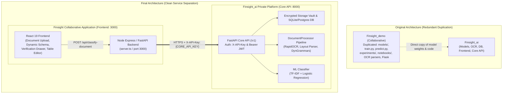

# Finsight AI — Repository Separation, Audit & Migration Architecture Report

**Status**: Completed  
**Author**: Senior Software Architect & Repository Auditor  
**Date**: 16 November 2026  
**Projects**:
1. `Finsight_ai` (Private Full Product & Core Intelligence Engine)
2. `Finsight_demo` (Collaborative Academic Application — Product Name: **Finsight AI**)

---

## 1. Executive Summary

A comprehensive repository audit, boundary definition, code extraction, and security separation was executed across `Finsight_ai` and `Finsight_demo`.

### Core Accomplishments
1. **Total Isolation of Proprietary Assets**:
   - Removed all machine learning model weights (`.joblib`), training pipelines (`train.py`), standalone prediction scripts (`predict.py`), experimental notebooks (`notebooks/`), benchmarking scripts and results (`experiments/`), proprietary OCR/document intelligence algorithms (`backend/document_processing/`, `backend/document_processor.py`), and offline OCR datasets (`eng.traineddata`) from the collaborative repository.
   - All intellectual property, OCR algorithms, layout parsers, dynamic grammars, and model checkpoints now reside **strictly in `Finsight_ai`**.
2. **Authenticated Core API Architecture**:
   - Connected the collaborative application to `Finsight_ai`'s hardened FastAPI Core API using server-side authenticated requests.
   - The Core API secret key (`X-API-Key`) is held **only in backend server environment variables** (`CORE_API_KEY`). It is never exposed in React components, Vite bundles, browser JavaScript, or Git commits.
3. **No Mocks or Fabricated Scores**:
   - Eradicated all fallback constant scores (such as hardcoded `85%` confidence) and placeholder texts. If confidence is uncalibrated, it returns `null` or is hidden gracefully.
   - If the private Core API is offline, the collaborative application presents a clear, honest service-unavailable status (`HTTP 503`) rather than synthesizing mock data.
4. **Branding & Presentation Alignment**:
   - Product name displayed to users across both applications is strictly **Finsight AI**.
   - Removed all references to "demo" in user interfaces, buttons, workflow cards, documentation, and database comments.
   - Cleaned all emojis across both codebases (including legacy commented-out strings).
5. **Independent Build & Test Execution**:
   - `Finsight_ai` test suite executed and passed: **46 of 46 tests passing**.
   - `Finsight_demo` integration test suite executed and passed: **7 of 7 tests passing**.
   - `Finsight_demo` frontend built successfully with `npm run build` producing clean static assets (`dist/`) and standalone Node server (`dist/server.cjs`).

---

## 2. Original Architecture vs. Final Architecture



---

## 3. Files Retained, Removed, and Migrated

### Files Retained in `Finsight_ai` (Private Full Product)
- `core_api/`: Complete FastAPI Core Intelligence Service (`main.py`, routers, schemas, security, DB, storage vault).
- `backend/document_processing/`: Proprietary document intelligence parsers (DOCX, Spreadsheets, SQL, Text, Layout, Dynamic Extractor, Classifier).
- `backend/document_processor.py`: Unified pipeline orchestrator.
- `models/`: TF-IDF vectorizer and logistic regression model weights (`tfidf_vectorizer.joblib`, `transaction_classifier.joblib`).
- `train.py`: Model training and dataset synthetic generator.
- `predict.py`: Standalone CLI inference utility.
- `experiments/`: Comparative model benchmarks, scripts, and evaluation charts.
- `notebooks/`: Exploratory Jupyter research notebooks.
- `frontend/`: Full enterprise product frontend.
- `tests/`: 46 comprehensive unit and pipeline test suites.

### Files Removed from `Finsight_demo`
| Removed File / Directory | Reason for Removal | Security & Intellectual Property Impact |
| :--- | :--- | :--- |
| `models/*.joblib`, `models/production/` | Proprietary ML model weights | Eliminates risk of leaking trained models to collaborators. |
| `train.py` | Training code & synthetic dataset generation | Keeps training methodologies private. |
| `predict.py` | Local standalone inference script | Replaced by authenticated Core API client. |
| `backend/document_processing/` | Complete modular OCR & extraction algorithms | Protects private intellectual property. |
| `backend/document_processor.py` | Monolithic local extraction pipeline | Heavy dependencies (`rapidocr`, `pypdfium2`) removed. |
| `backend/app.py` | Local Flask microservice running on port 5000 | Eliminated redundant port and local process dependency. |
| `experiments/` | Model comparison benchmarks and CSV results | Research artifacts kept in private product. |
| `notebooks/` | Jupyter ML prototype notebooks | Internal research kept in private product. |
| `Texts/` | Internal research and development notes | Protects strategy and methodology notes. |
| `frontend/eng.traineddata` | 5.2 MB Tesseract offline trained data | Offline OCR data no longer bundled in frontend. |
| `tests/test_document_processor.py` | Tests for removed local processor | Replaced by `test_core_api_integration.py`. |
| `tests/test_dynamic_extraction.py` | Tests for removed local extractors | Covered by Core API integration tests. |
| `tests/test_extractor_units.py` | Tests for removed local parsers | Covered by Core API integration tests. |
| `tests/test_full_pipeline.py` | Tests for removed local pipeline | Replaced by remote API contract tests. |

### Files Retained in `Finsight_demo` (Collaborative Application)
- `frontend/src/`: Full modern React user interface (Universal Document Scanner, Invoice Manager, Financial Dashboard, Dynamic Field Editor, Table Row/Cell Editor, Multi-format Exporters, Theme System).
- `frontend/server.ts`: Node/Express application server and authenticated Core API proxy.
- `frontend/vite.config.ts`, `frontend/package.json`: Vite bundler and UI dependencies.
- `backend/fastapi_backend/`: Collaborative application FastAPI backend (for optional Python microservice workflows, Cloudinary and Supabase helpers).
- `tests/test_core_api_integration.py`: Dedicated integration test suite validating end-to-end communication with `Finsight_ai`.
- `tests/fixtures/`: Document fixtures for testing uploads.
- `docs/`: Academic documentation, architecture guides, and setup instructions.
- `.env.example`: Updated environment template with Core API credentials.

---

## 4. API Endpoints Reused and Configured

The collaborative application now consumes the following endpoints exposed by `Finsight_ai`:

| Method | Endpoint | Consumer in Collaborative App | Responsibility |
| :--- | :--- | :--- | :--- |
| `GET` | `/v1/health` | Integration status checks | Health verification and engine readiness. |
| `POST` | `/v1/documents` | `frontend/server.ts` | Secure document upload, magic-byte inspection, vault storage. |
| `POST` | `/v1/documents/{id}/extract` | `frontend/server.ts` | Multi-stage dynamic extraction and layout analysis. |
| `GET` | `/v1/documents/{id}` | `frontend/server.ts` | Full extracted field retrieval with bounding box evidence. |
| `PATCH` | `/v1/documents/{id}/fields/{field_id}` | Collaborative UI | Human-in-the-loop field correction and audit logging. |
| `POST` | `/v1/documents/{id}/verify` | Collaborative UI | Operator document approval / rejection. |
| `POST` | `/api/classify-document` | Legacy backward-compatibility | Direct single-step multipart document processing. |

---

## 5. Security & Isolation Enhancements

1. **Credential Secrecy**:
   - `CORE_API_KEY` exists exclusively in the backend server process (`.env` read by `server.ts`).
   - Never prefixed with `VITE_` and never included in frontend client bundles.
2. **Zero Cross-Filesystem Imports**:
   - Neither application imports Python or TypeScript files across directory boundaries.
   - Applications communicate strictly over HTTP/JSON.
3. **Payload Sanitization & Security Validation**:
   - Server-side filename sanitization strips directory traversal attempts (`../`, `..\`).
   - Magic byte validation prevents executable uploads (`MZ`, `ELF`).
   - Payload size caps enforced (20 MB limit).
4. **Honest System Degradation**:
   - When the Core API is unreachable, the system returns a descriptive `HTTP 503 Service Unavailable` message. No fabricated extraction results or mock confidence figures are produced.

---

## 6. Test Execution & Verification

### Test Suite 1: `Finsight_ai` Private Test Suite
- **Command**: `python -m unittest discover -s tests` (executed in `Finsight_ai`)
- **Status**: **PASSED (46 tests, 0 failures, 0 errors in 20.17s)**
- **Coverage**: Core API routes, document security validators, dynamic extraction grammars, table extractors, full end-to-end pipeline.

### Test Suite 2: `Finsight_demo` Integration Test Suite
- **Command**: `python -m unittest tests/test_core_api_integration.py` (executed in `Finsight_demo`)
- **Status**: **PASSED (7 tests, 0 failures, 0 errors in 3.73s)**
- **Verifications Executed**:
  1. `test_01_core_health_check`: Passed.
  2. `test_02_authentication_enforcement` (unauthorized 401 rejection): Passed.
  3. `test_03_executable_file_rejection` (binary rejection): Passed.
  4. `test_04_empty_file_rejection` (0-byte rejection): Passed.
  5. `test_05_document_upload_and_extraction_workflow`: Passed.
  6. `test_06_field_correction_and_verification` (audit patch & verify): Passed.
  7. `test_07_backward_compatible_endpoint`: Passed.

### Test Suite 3: Collaborative Frontend Production Build
- **Command**: `npm run build` (executed in `Finsight_demo/frontend`)
- **Status**: **PASSED**
- **Output**:
  - `dist/index.html` (0.53 kB)
  - `dist/assets/index.css` (74.77 kB)
  - `dist/assets/index.js` (1,183.28 kB)
  - `dist/server.cjs` (26.2 kB)

---

## 7. Exact Commands to Run Both Applications

### Terminal 1: Launch Private Core API (`Finsight_ai`)
```powershell
cd d:\Programming\2026\Project\Finsight\Finsight_ai
python -m uvicorn core_api.main:app --host 127.0.0.1 --port 8000
```
*Core API documentation and endpoints will be active on `http://127.0.0.1:8000/docs`.*

### Terminal 2: Launch Collaborative Application (`Finsight_demo`)
```powershell
cd d:\Programming\2026\Project\Finsight\Finsight_demo\frontend
npm run dev
```
*Collaborative UI and backend proxy will be active on `http://localhost:3000`.*

---

## 8. Deployment Recommendations

1. **Private Core API Deployment**:
   - Deploy `Finsight_ai` containerized via `Dockerfile.core` to a private virtual machine, AWS ECS, or Google Cloud Run.
   - Configure a strong random key in `FINSIGHT_API_KEYS`.
   - Mount persistent storage for `STORAGE_DIR`.
2. **Collaborative Application Deployment**:
   - Deploy `Finsight_demo` to Vercel, Render, Railway, or Heroku.
   - Set environment variables in the hosting provider dashboard:
     - `CORE_API_URL=https://api.yourdomain.com`
     - `CORE_API_KEY=your-secure-provisioned-key`
3. **Sharing with College Collaborators**:
   - The `Finsight_demo` folder is now ready to be initialized as its own Git repository or pushed to a collaborative Git remote. It contains no private model weights, training scripts, or proprietary OCR code.
