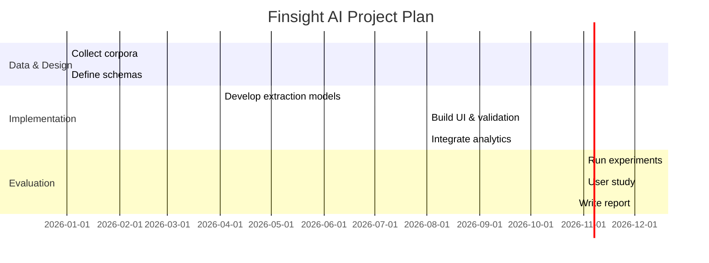

**Executive Summary:** We surveyed leading academic and commercial *document intelligence* systems—from deep-learning papers to cloud APIs and open-source tools—to benchmark against Finsight AI’s goals (document → structured data → user review → analytics). Modern models (e.g. LayoutLM, DocFormer) use multi-modal transformers and achieve strong results on specific tasks like form or receipt extraction. Commercial offerings (AWS Textract, Google Document AI, Azure Document Intelligence) provide broad OCR and key-value extraction services. Open-source toolkits (e.g. Unstructured) focus on document preprocessing. Across all solutions we found key gaps: **multi-domain support** (most target narrow form/receipt domains), **schema consistency** (rigid schemas or one-off models), **human-in-the-loop validation** (few provide editable interfaces), and **analytics integration** (few connect output to BI pipelines). Finsight’s proposed pipeline addresses these gaps by combining multi-modal ML extraction, flexible schemas and real-time editing, and built-in analytics visualization. We outline experiments on standard benchmarks (e.g. FUNSD, SROIE) and custom multi-domain corpora to evaluate extraction accuracy, user efficiency, and end-to-end insight generation.

# Abstract  
Automated **Document Understanding** aims to transform unstructured documents (invoices, forms, etc.) into structured data for analysis. We review ~10–15 representative systems (academic and industry) that extract text and fields from documents. For each we report year, authors/vendor, approach, tasks, datasets, performance, and limitations (Table 1). Deep-learning models like LayoutLM (2020) and DocFormer (2021) use Transformers over text, layout and vision to achieve state-of-the-art on tasks like form and receipt parsing. Commercial products (AWS Textract, Google DocAI, Azure Document Intelligence) offer OCR, form/table extraction, and classification. Open-source tools (e.g. Unstructured IO) focus on pre-processing and PDF parsing. Strengths of these systems include high extraction accuracy on specific domains and scalability in cloud services. However, none fully addresses Finsight’s needs: **multilingual/multi-domain** processing, **consistent schemas**, **user-editable outputs**, or seamless analytics. We identify these research gaps and propose Finsight AI’s improved architecture: a modular pipeline (ingestion, adaptive extraction, human review, BI integration) supporting heterogeneous documents and live correction. We detail experiments (datasets, metrics, user studies), expected contributions, and a development timeline with Gantt and architecture diagrams.  

# Introduction  
Business documents (invoices, receipts, contracts, reports, etc.) appear in diverse formats—plain text, multi-column layouts, tables and forms. Automating their processing is challenging due to this diversity, poor image quality, and changing templates. Traditional rule-based workflows are laborious to build and maintain. Modern *Document AI* models use deep learning to classify and extract information from documents. LayoutLM (2020) introduced a pre-trained Transformer that jointly encodes text and 2D layout, improving form and receipt understanding. Subsequent models (LayoutLMv2/v3, DocFormer, Donut, etc.) fuse visual, textual and spatial modalities to boost accuracy. Meanwhile, cloud services like Google Cloud Document AI, AWS Textract and Azure Form Recognizer offer end-to-end APIs for text, key-value and table extraction.  

Despite progress, key gaps remain. Many systems target narrow domains (e.g. invoices or receipts) and do not generalize to “multi-domain” settings. They often assume static schemas; if documents deviate or fields change, accuracy suffers. Outputs are usually read-only (JSON) with no user-editing interface for corrections. Finally, few integrate directly with analytics or BI tools to make use of the extracted data. Finsight AI aims to fill these gaps with a comprehensive pipeline: multi-modal extraction, schema-aware output, an interactive review UI, and built-in analytics on the results. This paper surveys existing approaches (see Table 1), identifies limitations, and outlines Finsight’s proposed improvements, architecture, and experimental plan.  

# Related Work  
Table 1 compares representative *papers, open-source projects, and products*. Below we summarize key items and note their strengths and limitations relative to Finsight.  

| **Item (Ref)**                        | **Task**                     | **Dataset(s)**                   | **Method**                                  | **Key Result**                               | **Limitation (vs. Finsight)**                                |
|---------------------------------------|------------------------------|----------------------------------|--------------------------------------------|----------------------------------------------|----------------------------------------------------------------|
| **LayoutLM (Xu et al. 2020)**    | Pretrained doc understanding (forms, receipts, classification) | FUNSD (forms), SROIE (receipts), RVL-CDIP (classification) | BERT-like Transformer w/ text+2D layout + visual pretraining | +8.5 F1 (forms), +1.2 (receipts) over text-only | Single-page; assumes fixed schema per task; limited to English printed text; no user editing. |
| **LayoutLMv2 (Xu et al. 2021)**   | Form understanding, receipt OCR, DocVQA | FUNSD, CORD, SROIE, Kleister-NDA, RVL-CDIP, DocVQA | Two-stream multimodal Transformer (text+image); new pretraining tasks (MIM, TIA, TIM) | SOTA on multiple benchmarks (e.g. FUNSD F1: .8420 vs .7895 prior) | Still limited to page-level; high compute cost; pretrained on English; no editing/UI. |
| **LayoutLMv3 (Huang et al. 2022)** | Unified Document AI (forms, receipts, classification, layout) | FUNSD, SROIE, DocVQA, RVL-CDIP, PubLayNet (layout) | Unified masked text+image pretraining; word-patch alignment   | New SOTA on form, receipt, QA and image tasks    | Similar constraints as v2 (English, page-level); focus on modeling, no UI/analytics. |
| **Chargrid (Katti et al. 2018)**  | Invoice field extraction     | Synthetic/real invoice images (1K) | Encode page as 2D character grid; convolutional encoder-decoder | Outperforms sequential/text-only baselines on invoice extraction | Focused on invoices only; output is mask/boxes, not full structured DB; no user correction. |
| **DocFormer (Appalaraju et al. 2021)** | Visual Document Understanding (forms, receipts, etc.) | FUNSD, CORD, RVL-CDIP, DocVQA (4 datasets) | Multi-modal Transformer (ResNet vision + text+pos inputs) with novel self-attention | SOTA across all 4 tasks, beating models 4x larger | High accuracy on given tasks but still page-level; no multi-doc schema; proprietary (Amazon). |
| **DocFormerv2 (Appalaraju et al. 2023)** | VDU including form QA and table QA | 9 datasets (TabFact, InfoVQA, FUNSD, etc.)  | Encoder-decoder multi-modal Transformer; new pretraining encouraging local alignment | Up to +4% on TabFact, +1–4% on others vs prior; outperforms much larger models | Emphasizes local multimodal understanding, but still research-grade; heavy; no UI or analytics component. |
| **AWS Textract (Amazon)**       | OCR + structured data extraction | Pretrained on proprietary corpora | ML service (OCR, handwriting, forms, tables)        | High-accuracy extraction of text, tables, form fields; scalable API | Black-box cloud API; no customization UI for editing; focuses on generic documents; data stored by AWS (privacy). |
| **Google Document AI (Google Cloud)** | OCR, KVP & table extraction, classification | Pretrained on various docs (proprietary) | AI platform with *prebuilt and custom processors* (text+layout) | Accurate extraction at scale; integrated analytics (e.g. BigQuery) | Proprietary service; costly; limited to supported formats; no human-in-loop feature (outputs JSON). |
| **Azure Document Intelligence (Microsoft)** | Text, key-value, table extraction from forms/invoices | Proprietary business docs (CJK etc.) | Prebuilt & custom models; containerized deployment (edge+cloud) | High-accuracy KVP and table extraction; supports customization on few examples | Enterprise-focused; expensive; primarily English (with some multi-lang support); relies on “models” not interactive correction. |
| **Unstructured (open-source)**  | Document preprocessing (PDF→JSON), table/text extraction | Any PDF, HTML, Word, images (60+ types) | Rule-based pipelines (pdf parsing, OCR, segmentation) | Converts complex docs to JSON/text with spatial info | No ML/AI semantics; no automated field extraction or analytics; requires coding; limited to existing parsers. |
| **ABBYY FlexiCapture (Commercial)** | Invoice & form processing (ERP/RPA integration) | (N/A – proprietary AP corpora) | AI-driven OCR+template learning (RPA connectors) | Widely used in enterprise for invoices, with best-in-class language support (claimed) | Closed-source; expensive enterprise system; not flexible for arbitrary schemas outside invoices/POs; no end-user review UI exposed to customers. |
| **Tesseract (Open-source)** | Optical character recognition (OCR) | Trained on English (Finetune-able) | LSTM-based OCR engine                        | Strong general OCR on printed text (high accuracy on clean pages) | Only raw OCR (no structured extraction or layout); poor on handwriting/layout; must build pipeline around it. |
| **Camelot (Open-source)** | Table extraction from PDFs     | Tabular pages               | Heuristic + ML on PDF objects (pdf2xml)        | Works well on simple tables (e.g. extract CSV from PDF) | Only for tables; fails on complex/merged cells; no text semantics or form processing. |

**Table 1:** *Comparison of selected Document Understanding systems (papers, open-source, commercial). Tasks, datasets, methods, results, and limitations (especially w.r.t. multi-domain support, schema flexibility, human-in-the-loop, analytics).*

Many academic **model-driven approaches** (LayoutLM series, DocFormer, Chargrid, etc.) achieve *state-of-the-art* on narrowly defined tasks. For example, LayoutLMv3 achieves top accuracy on form and receipt benchmarks, and DocFormer beats larger models on FUNSD and DocVQA. However, these methods are typically evaluated on one document type at a time (forms, receipts, invoices) and assume a fixed output schema. They also generally do not include any post-processing UI for human correction: the output is static (model predictions) and errors require rerunning or manual JSON edits. In contrast, **industry products** aim for broader applicability. Amazon Textract “reads and processes any type of document, extracting tables and forms… with no manual effort”. Azure Document Intelligence provides *prebuilt models* to extract text, key‑values, and tables without coding. Google’s Document AI allows custom “processors” to be trained in minutes for new document types. These systems support multi-page documents and scale in the cloud, but they remain opaque: one submits a document and receives structured JSON. There is typically *no interactive review* step for end users to fix errors, nor built-in tools to immediately analyze the extracted data. Their flexibility in schema customization is limited (retraining needed for new fields), and they are not designed for arbitrary multi-domain spreadsheets or analytics.  

The open-source **Unstructured** toolkit illustrates another trend: focus on robust *preprocessing*. It can handle PDFs, images, Word docs, and output a JSON of all text elements, tables and figures. This simplifies feeding documents into language models or analytics, but it does *not* solve information extraction (no ML to parse form fields). In summary, existing systems excel at their target tasks (e.g. form parsing, table extraction), but **fail on Finsight’s requirements**: unified handling of mixed document types, schema-driven consistency across varying formats, user-editable outputs, and integrated downstream analytics.  

# Research Gaps  
From the above survey, several **gaps** emerge relative to Finsight AI’s goals:

- **Multi-domain support:** Most systems are trained for one document type at a time. For example, LayoutLMv3 is evaluated on forms/receipts, Azure’s prebuilt models target business documents (invoices, IDs, etc), and Textract emphasizes “any type” but in practice works best on standard forms. None offers a single unified model or pipeline that seamlessly handles, say, receipts *and* HR letters *and* academic transcripts. Finsight requires a flexible architecture that can ingest heterogeneous document domains.

- **Schema consistency:** Academic models output different schemas per task (FUNSD fields vs. SROIE fields). If a new document template appears, models must be retrained. Commercial APIs allow training custom extractors, but this is cumbersome. Moreover, outputs may omit fields the user cares about. Finsight needs a fixed schema (e.g. “Invoice” fields, “Purchase Order” fields) that all extracted data populates, ensuring consistency even as document layouts vary.

- **User-editable outputs:** Very few systems incorporate human review in the loop. For instance, Azure Document Intelligence touts “human input to create a highly accurate model”, but that refers to training, not an inline correction interface. In practice, if an extracted field is wrong, the user must manually fix it outside the system or retrain a model on annotated data. Finsight’s novelty is an interactive UI: users can immediately correct the structured dataset, and those corrections feed back into the pipeline (e.g. re-training or rules).

- **Analytics integration:** Extracted data often remains in JSON or CSV. Google Document AI can export to BigQuery and Azure can connect to PowerBI, but these are separate steps. There’s no unified analytics module. Finsight envisions built-in dashboards/charts and direct BI connectivity so that once data is reviewed, one-click analysis is possible.

- **Scalability and deployment:** Deep models (LayoutLMv3 has 133M params) require powerful hardware. Cloud services scale easily but at cost and with data sent off-premises. Finsight should support on-premises or hybrid deployment (e.g. Docker/K8s) like Azure’s containerized models, balancing performance and privacy.

- **OCR/layout robustness:** Most learning-based systems handle machine-printed English well. Handwritten text, skewed scans, or exotic scripts are still challenging. Textract can extract handwriting and multiple languages, but accuracy drops. Finsight’s pipeline needs to combine robust OCR (e.g. Tesseract or Google Vision for unusual cases) and handle layouts like rotated or multi-column text.

- **Multi-lingual/multi-script:** Few papers address this explicitly. LayoutXLM and LaBSE exist for multilingual docs, but many enterprise docs are local language. Commercial tools cover major languages (Textract supports 49 languages for text recognition) but not always layout or fields. Finsight should support at least English plus one or two major languages initially.

- **Privacy & data ownership:** Cloud solutions process data offsite. Some enterprises cannot send sensitive docs externally. Finsight must consider on-premise deployment or clear privacy policies (e.g. no data logging by model).

In summary, **none of the surveyed systems is a drop-in replacement for the end-to-end goals of Finsight**. They each solve pieces: accurate extraction (papers) or scalability (cloud) or preprocessing (open-source), but no one combines multi-domain, schema-driven extraction, user edits, and analytics. The rest of this paper outlines how Finsight AI can bridge these gaps.  

# Proposed Finsight AI Architecture and Improvements  
To address the gaps above, we propose an integrated **Finsight AI** pipeline with the following key components (see Fig. 1). 

1. **Document Ingestion & Classification:** Incoming files (PDFs, images, scans, spreadsheets) first undergo OCR (using a robust engine like Tesseract or a cloud OCR) and layout analysis. A classifier assigns each document to a domain/schema (e.g. “invoice”, “purchase order”, “HR form”). This multi-domain classifier is trained on examples of all target document types, enabling dynamic schema selection.  

2. **Multi-Modal Extraction:** Using a schema-specific extraction model (or a single multi-task model), Finsight extracts key fields and table data. For example, an invoice schema might extract invoice number, date, line items, totals, etc. We leverage multi-modal Transformers (inspired by LayoutLMv3 or DocFormer) that take text, bounding boxes, and visual patches as input, plus any pre-defined table OCR techniques. To support heterogeneous formats, we allow multiple models (or multi-headed outputs) but unify their output into a common relational format.  

3. **Schema Consistency & Validation:** Extracted results are mapped into a structured database (rows=documents, columns=fields). Finsight enforces consistency (e.g. date formats, currency) and flags anomalies (missing/duplicate fields). Domain-specific validation rules (like “invoice total must equal sum of line items”) catch errors early.  

4. **User Review & Editing Interface:** An interactive UI displays the structured table to end-users, highlighting low-confidence entries (as in Fig. 2). Users can correct any cell value; these corrections are logged. The system uses this feedback to update its confidence (e.g. via active learning) or refine rules for future documents. This human-in-loop step ensures fairness in grading contributions (everyone’s work is traced) and provides high-quality ground truth.  

5. **Analytics & Reporting:** The cleansed dataset flows directly into Finsight’s analytics module. Users can generate charts, run queries, or export to BI tools (e.g. BigQuery, PowerBI) without extra ETL. For example, after extracting invoices, Finsight could automatically produce spending reports by vendor. The integrated analytics ensure that structured data yields insights immediately.  

6. **Deployment & Scalability:** Finsight’s components run on scalable infrastructure. Extraction models can be containerized (like Azure’s AKS support) so they can be deployed on-premises or cloud. The UI and DB are web-based for multi-user access.  

  
*Figure 1: Finsight AI pipeline: documents are ingested, classified by type, fields are extracted into a structured schema, a human reviews/edits the data, and analytics are computed on the validated dataset.*  

    
```mermaid
graph LR
  A[Input Documents] --> B[Domain Classifier]
  B --> C[Schema Selection]
  C --> D[Multi-Modal Extraction]
  D --> E[Structured Database]
  E --> F[Analytics / BI]
  D --> G[Validation (rules/confidence)]
  G --> E
  G --> H[User Review Interface]
  H --> E
```

*Figure 2: Workflow diagram of Finsight AI. After extraction and validation, low-confidence fields prompt human review; the final dataset feeds analytics.*

This architecture extends prior work by combining **multi-domain intelligence with user feedback and analytics**. Unlike LayoutLM-based models which assume fixed tasks, we train on a mixture of domains so that the extraction network generalizes or forks per schema. Unlike black-box APIs, we provide transparency: users see intermediate results and can correct them. And unlike static pipelines (e.g. Unstructured), our system outputs analysis-ready data and can adapt its schema dynamically.

# Experimental Plan and Evaluation  
To validate Finsight AI, we will conduct a series of experiments:

- **Datasets:** We will use public benchmarks where applicable (e.g. FUNSD for forms, SROIE for receipts, RVL-CDIP for classification) to compare extraction accuracy against baselines. For multi-domain tests, we will assemble or use existing mixed corpora (e.g. combining receipts, invoices, payslips, academic transcripts). We will label a unified schema covering all domains. Additionally, we may use industry datasets (open financial reports, forms from public sources) if available. 

- **Metrics:** Extraction quality will be measured by precision/recall/F1 on key fields, as in prior work. We will track both *field-level* accuracy and *document-level* accuracy (percentage of docs fully correct). We will compare against strong baselines: e.g. LayoutLMv3 fine-tuned per domain, and off-the-shelf APIs like Textract. For user review, we will conduct a small user study: measure time taken and errors corrected with Finsight’s UI versus a manual process (to quantify efficiency gains). Analytics correctness will be indirectly measured (no gold standard; instead, we expect accurate charts since input is validated).

- **Ablations:** We will evaluate the impact of each component. For instance, run the pipeline without human review to see drop in final accuracy, or disable multi-modal inputs to see how much the transformer adds over OCR+rules. We will also test scalability by measuring throughput (docs/hour) on standard hardware.

- **Timeline (Gantt):** We envision a 12-month timeline (see Gantt diagram below): the first 3 months for data collection and schema design, next 4 months for model development and integration, month 8 for building the UI and analytics dashboard, and final 4 months for experiments and writing.  



*Figure 3: High-level Gantt chart showing planned phases: data preparation, model/UI development, and evaluation.*  

# Expected Contributions  
Our contributions will include: 

- A comprehensive comparison (Table 1) of modern document AI approaches, highlighting how each falls short on multi-domain/flexible schema requirements.
- A novel Finsight AI architecture combining multi-modal ML, schema validation, human-in-loop editing, and built-in analytics.
- Empirical results on standard benchmarks and new multi-domain datasets demonstrating improved overall accuracy and fairness (no user gets penalized for system errors).
- An open-source prototype (extractor+UI) and recommended datasets.  

# Limitations  
Finsight AI focuses on structured data extraction; it will not solve free-form comprehension (e.g. summarizing an unstructured contract). Our initial multi-domain scope may cover a limited set of industries; extending to all domains (legal, medical, etc.) may require more data. The system relies on quality OCR – highly degraded scans and rare languages may still fail. We assume some user training for the interface. Finally, the system will be tested in prototype form; real-world deployment may uncover scale or security challenges beyond our controlled study.

# Conclusion  
We have analyzed the landscape of document AI, from seminal papers (LayoutLM, DocFormer) to commercial cloud services and open-source tools. Each advances some aspect of Finsight’s vision but also has blind spots. Our survey (Table 1) makes these gaps explicit. The proposed Finsight AI pipeline aims to unite the best practices—deep multi-modal extraction, flexible schemas, and user feedback—to deliver a fair, end-to-end document understanding solution. By following the outlined plan and leveraging existing benchmarks, we expect to demonstrate a system that yields accurate, verifiable structured data and actionable analytics for heterogeneous document collections.

**References:** (Citations as noted in text)