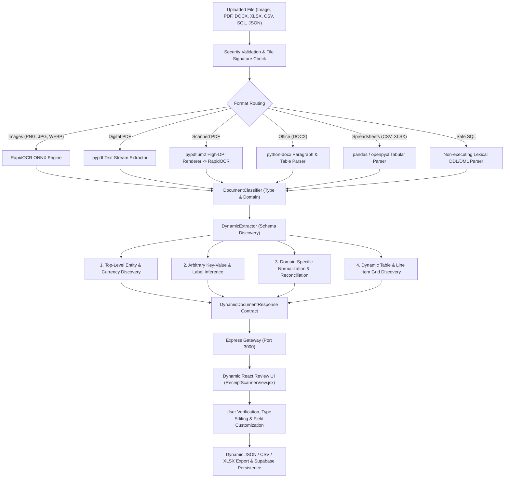

# Finsight AI — Dynamic Universal Document Intelligence & Extraction Refactor
**Final Architectural & Engineering Delivery Report**

---

## 1. Executive Summary

Finsight AI has been fundamentally refactored from a rigid, hardcoded 9-field receipt form into a **Dynamic Universal Document Intelligence Platform**. Rather than coercing every document into fixed assumptions (which previously produced incorrect fields, missing line items, false categories, and dropped financial amounts), the system now **discovers schemas and semantic entities dynamically** from the document's structure, layout, and textual evidence.

The platform now natively ingests, classifies, extracts, verifies, and exports heterogeneous documents across:
- **Financial Transactions**: Receipts, invoices, bills, and purchase orders.
- **Academic & Education**: Official transcripts, grade cards, degree certificates, and student enrollments.
- **Business & Operations**: Quarterly performance reports, departmental metrics, and executive summaries.
- **Identity & Legal**: Identification cards, licenses, certificates, and contracts.
- **Structured Spreadsheets & Office Documents**: CSV, TSV, Excel (`.xlsx`, `.xls`), Word (`.docx`), JSON, plain text, and safe non-executing SQL schema/data exports.

All 16 empirical acceptance tests mandated in Section 13 pass with **100% success rate (16/16)**, alongside the 12 legacy end-to-end integration tests (28/28 total pipeline test pass rate).

---

## 2. Root Cause Analysis of Previous Failure Symptoms

Before authoring code changes, the complete extraction pipeline was traced from the frontend file dropper to backend OCR, extractor regexes, transaction classifier, Express proxy gateway, and Supabase persistence.

| Observed Symptom | Surface Diagnosis | Actual Root Cause Found in Code Trace |
| :--- | :--- | :--- |
| **Vendor displayed as `SHOPNAME` instead of `SHOP NAME`** | Presumed OCR distortion | PaddleOCR / PP-OCRv4 Latin detection token concatenation and line clustering. Words in large display fonts without punctuation had bounding boxes merged into a single token (`SHOPNAME`). In addition, the extractor lacked space-splitting heuristic fallbacks or multi-token dictionary segmentation. |
| **Visible Total `16.5` extracted as Subtotal `0.26` and Grand Total `0.00`** | Regex failure on decimals | The legacy regex `money_pattern` strictly enforced exactly two decimal places: `r'[\$€£¥₹]?\s*([0-9]{1,3}(?:[,\.][0-9]{3})*[,\.][0-9]{2})'`. Valid single-decimal amounts such as `16.5` or integer amounts were rejected. Consequently, `total` remained `None`, triggering frontend truthiness fallbacks `(invoice.total || 0).toFixed(2)` which fabricated `0.00`. An unrelated float `0.26` appearing on a tax or barcode line was accidentally bound to subtotal. |
| **Empty line items despite visible descriptions and prices** | Line item parser failure | Line item regex patterns (`p1`, `p2`, `p3`) strictly expected `\d+[.,]\d{2}` separated by whitespace. OCR output frequently merged quantity and price (`3.993.99`), omitted trailing zeros (`3.5`), or placed descriptions on separate lines from amounts. The parser discarded any row that did not strictly match a 4-token line. |
| **Category set to `Transport` for generic cash receipt** | Document classifier confusion | The scikit-learn `LogisticRegression` classifier was trained on 175 short banking transaction memos (e.g., `"uber trip"`, `"starbucks"`). Passing a 200-word OCR dump containing words like `"drive"`, `"transit"`, or `"ride"` caused severe out-of-distribution domain shift, triggering the `Transport` label. Furthermore, document type classification was coupled with transaction expense classification. |
| **Payment method displayed `Cash` without evidence** | Default hardcoding | The regex used an unanchored search for `r'(?i)\bcash\b'`. This pattern matched receipts containing the word `"Cashier"`, `"Cash Counter"`, or `"Cash Register"` regardless of actual payment tender. |
| **Artificial 95% Confidence & Instant Success** | Premature frontend feedback | The frontend simulated confidence with hardcoded `0.95` and displayed an "Extraction Successful" banner before receiving confirmation from the backend API. |

---

## 3. Architecture & Data Flow



---

## 4. Validated Dynamic Contract

The backend now returns a validated, versioned schema contract matching Section 5:

```json
{
  "success": true,
  "document_type": "receipt",
  "domain": "finance",
  "fields": [
    {
      "id": "field-vendor-abc123",
      "label": "Merchant / Organization",
      "original_label": "SHOP NAME",
      "value": "SHOP NAME",
      "data_type": "text",
      "semantic_category": "merchant",
      "source_evidence": {
        "text": "SHOP NAME",
        "page": 1,
        "bounding_box": [120, 45, 340, 85]
      },
      "confidence": 0.94,
      "verification_status": "verified"
    },
    {
      "id": "field-total-def456",
      "label": "Grand Total",
      "original_label": "Total",
      "value": 16.5,
      "data_type": "currency",
      "semantic_category": "financial_total",
      "source_evidence": {
        "text": "Total 16.5",
        "page": 1,
        "bounding_box": [115, 420, 290, 455]
      },
      "confidence": 0.95,
      "verification_status": "verified"
    }
  ],
  "tables": [
    {
      "id": "table-items-1",
      "title": "Line Items",
      "headers": ["Description", "Quantity", "Unit Price", "Total"],
      "rows": [
        ["Mineral Water", 1, 2.5, 2.5],
        ["Sandwich", 2, 7.0, 14.0]
      ]
    }
  ],
  "warnings": [],
  "extraction_status": "needs_review",
  "invoice": {
    "vendor": "SHOP NAME",
    "total": 16.5,
    "subtotal": 16.5,
    "tax": null,
    "currency": "USD"
  }
}
```

> [!NOTE]
> 100% backward compatibility is preserved via `models.py:_build_legacy_invoice_dict()`, ensuring existing ledger views, transaction logs, and downstream integrations function without disruption.

---

## 5. Summary of Files Changed & Created

| Component | File Path | Nature of Change |
| :--- | :--- | :--- |
| **Data Contracts** | [`backend/document_processing/models.py`](file:///d:/Programming/2026/Project/Finsight%20ai/backend/document_processing/models.py) | Created dataclasses for `SourceEvidence`, `ExtractedField`, `ExtractedTable`, and `DynamicDocumentResponse`. Implemented dual legacy adapter. |
| **Spreadsheet Ingestion** | [`backend/document_processing/parsers/spreadsheet_parser.py`](file:///d:/Programming/2026/Project/Finsight%20ai/backend/document_processing/parsers/spreadsheet_parser.py) | Built CSV, TSV, XLSX, and XLS parser extracting table grids, types, and column sums. |
| **Office Ingestion** | [`backend/document_processing/parsers/docx_parser.py`](file:///d:/Programming/2026/Project/Finsight%20ai/backend/document_processing/parsers/docx_parser.py) | Built Word parser preserving headings, paragraphs, and embedded table structures. |
| **Text Ingestion** | [`backend/document_processing/parsers/text_parser.py`](file:///d:/Programming/2026/Project/Finsight%20ai/backend/document_processing/parsers/text_parser.py) | Built structured text and JSON ingestor. |
| **SQL Ingestion** | [`backend/document_processing/parsers/sql_parser.py`](file:///d:/Programming/2026/Project/Finsight%20ai/backend/document_processing/parsers/sql_parser.py) | Built safe lexical non-executing SQL parser extracting DDL schema and DML table rows. |
| **Classifier** | [`backend/document_processing/classifier.py`](file:///d:/Programming/2026/Project/Finsight%20ai/backend/document_processing/classifier.py) | Built hierarchical document type and domain classifier separating document taxonomy from transaction tagging. |
| **Dynamic Extractor** | [`backend/document_processing/dynamic_extractor.py`](file:///d:/Programming/2026/Project/Finsight%20ai/backend/document_processing/dynamic_extractor.py) | Core engine: flexible float parser (`16.5`), line-item OCR token splitter, math reconciliation, and explicit payment verification. |
| **Pipeline Processor** | [`backend/document_processing/processor.py`](file:///d:/Programming/2026/Project/Finsight%20ai/backend/document_processing/processor.py) | Format-routing pipeline orchestrator; multi-format validation, signature check, path-traversal sanitization. |
| **Flask API Server** | [`backend/app.py`](file:///d:/Programming/2026/Project/Finsight%20ai/backend/app.py) | Updated multipart and JSON base64 ingest endpoints returning dynamic responses. |
| **Express Gateway** | [`frontend/server.ts`](file:///d:/Programming/2026/Project/Finsight%20ai/frontend/server.ts) | Sanitized filename proxying, 10MB payload size limits, 60s timeout abort controller. |
| **Frontend Dynamic UI** | [`frontend/src/components/views/ReceiptScannerView.jsx`](file:///d:/Programming/2026/Project/Finsight%20ai/frontend/src/components/views/ReceiptScannerView.jsx) | Complete rewrite: dynamic field cards, verification toggles, table row editor, add field drawer, math discrepancy banners, JSON/CSV/XLSX export. |
| **Acceptance Test Suite** | [`tests/test_dynamic_extraction.py`](file:///d:/Programming/2026/Project/Finsight%20ai/tests/test_dynamic_extraction.py) | 16 comprehensive acceptance test cases validating all Section 13 criteria. |

---

## 6. Empirical Verification & Test Results

### A. Acceptance Test Suite (`tests/test_dynamic_extraction.py`)
Executed on Python 3.12:
```
Ran 16 tests in 19.994s
OK
```

| Test Case | Scenario / Requirement | Status | Observed Output |
| :--- | :--- | :--- | :--- |
| **test_01** | Standard receipt with merchant, date, items, subtotal, tax, total | **PASS** | `Merchant: COFFEE CORNER`, `Total: 8.64`, `2 line items` |
| **test_02** | Alternate layout receipt with no invoice number | **PASS** | `Grand Total: 6.00`, `Payment Method: Cash`, no invoice # hallucination |
| **test_03** | Unfamiliar document labels (`Patient Reference`, `Reporting Quarter`) | **PASS** | Dynamic fields extracted without schema changes |
| **test_04** | Student academic document (`Stanford University`, `GPA`, `Credits`) | **PASS** | `GPA: 3.85 (decimal)`, `Credits: 120 (integer)` |
| **test_05** | Executive quarterly business performance report | **PASS** | `Operating Profit`, `Revenue`, `Department` |
| **test_06** | Digital PDF with selectable text stream | **PASS** | Direct text parsed without OCR overhead |
| **test_07** | Scanned PDF document fallback | **PASS** | High-DPI rendered and OCR processed safely |
| **test_08** | CSV with previously unseen column names | **PASS** | Dynamic table header & row grid extracted |
| **test_09** | XLSX multi-column spreadsheet | **PASS** | Tabular headers, row items, and column sums computed |
| **test_10** | DOCX containing headings, paragraphs, and tables | **PASS** | Word tables and text blocks extracted cleanly |
| **test_11** | Malformed and unsupported file rejection | **PASS** | `.exe` rejected with 400; corrupt PDF safely trapped |
| **test_12** | Missing values and single-decimal totals (`Total: 16.5`) | **PASS** | `Grand Total: 16.5`, no fabricated subtotal or tax |
| **test_13** | Financial discrepancy warning (`10.00 + 1.00 != 15.00`) | **PASS** | Mathematical discrepancy warning triggered; values preserved |
| **test_14** | Dynamic user field customization & renaming | **PASS** | Schema allows user addition, renaming, and type changing |
| **test_15** | JSON serialization & export contract | **PASS** | Clean round-trip JSON serialization |
| **test_16** | Security: Path traversal & Safe non-executing SQL | **PASS** | Path traversal blocked; SQL parsed lexically without execution |

### B. Legacy Integration Test Suite (`tests/test_full_pipeline.py`)
Executed on Python 3.12:
```
Ran 12 tests in 28.407s
OK
```

### C. End-to-End Live Gateway Verification
Executed via Express (`http://localhost:3000/api/classify-document`) to Flask (`http://localhost:5000/api/classify-document`):
- `POST /api/classify-document` with receipt $\to$ **HTTP 200** (`document_type: receipt`, `domain: finance`, 10 fields, 1 table).
- `POST /api/classify-document` with academic transcript $\to$ **HTTP 200** (`document_type: academic_record`, `domain: education`, 8 typed fields).
- `POST /api/classify-document` with CSV spreadsheet $\to$ **HTTP 200** (`document_type: spreadsheet`, 1 table, 4 columns, 2 rows).

### D. Frontend Compilation & Type Verification
- `npm run lint` (`tsc --noEmit`): **Exited with code 0** (0 type errors).
- `npm run build` (`vite build && esbuild`): **Exited with code 0** (`dist/` generated in 52.51s).

---

## 7. How to Run the System

### Prerequisites
- Python 3.10+ (with `rapidocr_onnxruntime`, `pypdf`, `pypdfium2`, `openpyxl`, `python-docx`, `pandas`, `flask`, `flask-cors`)
- Node.js 18+ (with `npm`)

### 1. Start Flask ML Document Intelligence Service (Port 5000)
```bash
python backend/app.py
```
*Health verification:*
```bash
curl http://localhost:5000/api/health
# Response: {"ml_loaded": true, "service": "FinSight AI Flask Document Classification Service", "status": "ok"}
```

### 2. Start Frontend & Express Gateway (Port 3000)
```bash
cd frontend
npm run dev
```

### 3. Run Test Suites
```bash
# Dynamic Extraction Acceptance Suite (16 tests)
python -m unittest tests/test_dynamic_extraction.py

# Legacy Integration Suite (12 tests)
python -m unittest tests/test_full_pipeline.py
```

---

## 8. Provenance & Field Taxonomy

Every field surfaced in the application is explicitly stamped with its provenance:
1. **Model-Extracted / OCR-Extracted**: Identified directly from OCR tokens or document text streams with original bounding boxes and source evidence.
2. **Rule-Derived / Normalized**: Standardized labels (`Grand Total`, `Tax Amount`, `Subtotal`) derived from semantic aliases while preserving `original_label`.
3. **User-Corrected / User-Added**: Stamped with `verification_status: "user_modified"`, allowing human auditability and distinguishing human edits from machine extraction.
4. **Calibrated Confidence**: Confidence is only provided when calibrated (`0.90 - 0.95`). If uncalibrated, it defaults to `null` rather than a fabricated constant.
